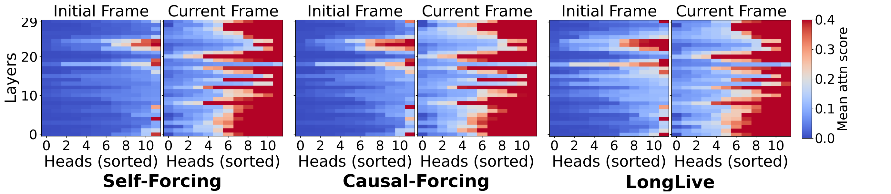
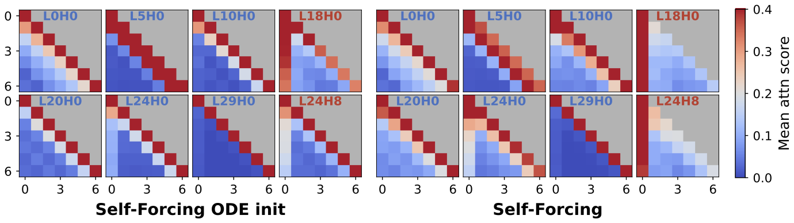

<div align="center">

<h1> Disen-Forcing</h1>
<h3>Disentangling Semantic Anchoring from Motion for Autoregressive Video Diffusion</h3>

<a href="https://www.linkedin.com/in/zhengyang-yu-67a9a2242">Zhengyang Yu</a><sup>1</sup>, <a href="https://ahykw.github.io/">Akio Hayakawa</a><sup>2</sup>, <a href="https://masato-ishii-mi141.github.io">Masato Ishii</a><sup>2</sup>, <a href="https://terryslearning.github.io">Qingtao Yu</a><sup>1</sup>,<br>
<a href="https://benzlxs.github.io">Xuesong Li</a><sup>1,3</sup>, <a href="https://yahshibu.github.io">Takashi Shibuya</a><sup>2</sup>, <a href="https://www.yukimitsufuji.com/">Yuki Mitsufuji</a><sup>2,4</sup>, <a href="https://jingzhang617.github.io">Jing Zhang</a><sup>1</sup>

<sup>1</sup>Australian National University &nbsp; <sup>2</sup>Sony AI &nbsp; <sup>3</sup>CSIRO &nbsp; <sup>4</sup>Sony Group Corporation

<h3><a href="https://arxiv.org/abs/2611.02822">Paper</a> | <a href="https://disen-forcing.github.io/">Project page</a> | <a href="https://huggingface.co/ZY-Dijkstra/Disen-Forcing">Model</a></h3>

</div>

https://github.com/user-attachments/assets/ded77142-a01c-4d2e-8012-95e9cac72b64

Long autoregressive video rollouts tend to drift. A popular fix, borrowed from streaming LLMs, is the [frame sink](https://arxiv.org/abs/2509.22622): keep the initial-frame tokens in the KV cache for the whole rollout, so every new chunk can look back at them. This keeps appearance stable, but we find that during distillation it tends to pull motion toward low-dynamic modes.

Why? In LLMs, the initial tokens act as an [attention sink](https://arxiv.org/abs/2309.17453) that attracts attention in most heads. In autoregressive video diffusion models, by contrast, our analysis shows that long-range consistency is carried by only a small subset of initial-frame-focused anchor heads, while most heads predominantly capture local temporal dynamics. Yet the frame sink exposes every head to the initial frames, and this over-conditioning drives the motion collapse by holding the video close to the initial frames.

<p align="center"></p>

*Attention pattern of AR-VDMs. Most heads attend to the current frame; only a few attend to the initial frame.*

The idea behind **Disen-Forcing** is simple: route the persistent initial-frame context only to the anchor heads, and regularize motion to be invariant to the initial-frame context. This improves long-horizon consistency and motion dynamics together.

This repository contains the training and inference code for Disen-Forcing on Wan2.1-T2V-1.3B.

## Features

- **Analysis**: anchor-head identification and attention map visualization as in our paper.
- **Training**: multi-node FSDP training with [gradient accumulation](configs/disen_4gpu.yaml) (fits on 4× H100 80 GB) and [**resuming training from any checkpoint**](#training).
- **Inference**: long video generation (5 s to 1 min) on one or more GPUs.

## Improved training recipe

This release uses an improved recipe over the paper:
- **Learnable context routing.** We find that the attention patterns of AR-VDMs can shift slightly during DMD training. We therefore replace the hard context routing with a learnable per-head gating on attention to the frame-sink frames, initialized based on the anchor heads measured on the initial model ([`sink_gate_logit`](wan/modules/causal_model_anchor_reg.py#L23-L26)).
- **EMA-based motion regularization.** The paper's counterfactual reference, which requires VAE re-encoding, is replaced by the student's EMA. Because the EMA evolves slowly, its motion collapse caused by initial-frame access is slower. We find this simple reference more efficient and stable to train with.
- **KV caching gradient.** We adopt the KV caching gradient from [Self Gradient Forcing](https://arxiv.org/abs/2607.20368), which improves overall quality and consistency. We find it helpful to scale this gradient down ([`cache_grad_scale`](wan/modules/causal_model_anchor_reg.py#L230-L233)), since the cache-writing timestep is trained at every step, while only one of the four denoising timesteps is trained per step.

## Installation

```bash
conda create -n disen python=3.10 -y
conda activate disen
pip install torch==2.5.1 torchvision==0.20.1 --index-url https://download.pytorch.org/whl/cu121
pip install -r requirements.txt
pip install flash-attn==2.8.3 --no-build-isolation
```

Models and prompts:

```bash
# Wan2.1 backbone (student) and 14B teacher (training only)
huggingface-cli download Wan-AI/Wan2.1-T2V-1.3B --local-dir wan_models/Wan2.1-T2V-1.3B
huggingface-cli download Wan-AI/Wan2.1-T2V-14B  --local-dir wan_models/Wan2.1-T2V-14B
# Causal Forcing chunk-wise ODE initialization (training only)
huggingface-cli download zhuhz22/Causal-Forcing chunkwise/causal_ode.pt --local-dir checkpoints/causal_forcing
# Training prompts (VidProM, filtered and extended, from Self-Forcing)
huggingface-cli download gdhe17/Self-Forcing vidprom_filtered_extended.txt --local-dir prompts
```

Evaluation prompts: MovieGenBench and its extended version from the Self-Forcing repository ([`MovieGenVideoBench.txt`](https://github.com/guandeh17/Self-Forcing/blob/main/prompts/MovieGenVideoBench.txt), [`MovieGenVideoBench_extended.txt`](https://github.com/guandeh17/Self-Forcing/blob/main/prompts/MovieGenVideoBench_extended.txt); put them in `prompts/`).

## Inference

```bash
huggingface-cli download ZY-Dijkstra/Disen-Forcing disen_forcing.safetensors --local-dir checkpoints
python inference.py --config configs/inference.yaml --checkpoint checkpoints/disen_forcing.safetensors \
    --prompts prompts/MovieGenVideoBench.txt --extended_prompts prompts/MovieGenVideoBench_extended.txt \
    --output_dir videos --num_output_frames 126 --seed 0
```

- `--checkpoint`: the released model, a training checkpoint, or a file written by [`scripts/export_release.py`](scripts/export_release.py).
- `--weights` (training checkpoints only): `ema_online_gate` (default, as in the released model), `ema`, or `generator`.
- `--num_output_frames` counts latent frames: 21 ≈ 5 s, 126 ≈ 30 s, 252 ≈ 1 min at 16 fps.
- Each prompt uses seed `seed + line index`, so results do not depend on the number of GPUs. Multi-GPU: `torchrun --nproc_per_node=N inference.py ...`.

Export release weights from a training checkpoint:

```bash
python scripts/export_release.py --checkpoint <run>/checkpoint_model_XXXXXX/model.pt \
    --output disen_forcing.safetensors --bf16
```

## Training

Two options, both 700 optimizer steps (64 samples each) with a checkpoint every 50 steps.

**Training without KV caching gradient:**

```bash
torchrun --nnodes=1 --nproc_per_node=8 train.py --config configs/disen.yaml --logdir outputs/disen
# 4 GPUs: gradient accumulation keeps the batch size
torchrun --nnodes=1 --nproc_per_node=4 train.py --config configs/disen_4gpu.yaml --logdir outputs/disen
```

**Training with KV caching gradient (recommended):**

```bash
bash scripts/train_cachegrad.sh            # 8 GPUs; set NPROC and OUT to change GPUs per node and the output root
```

Resume any run from a checkpoint (`checkpoint_model_XXXXXX` is numbered by micro-step, i.e. optimizer step × 8 with the default config):

```bash
torchrun --nnodes=1 --nproc_per_node=8 train.py --config <config> --logdir <logdir> --resume <logdir>/checkpoint_model_XXXXXX/model.pt
```

## Finding anchor heads

Anchor heads are the small subset of attention heads that keep attending to the initial frames throughout the rollout; most heads attend locally. The released configs include [anchor head indices](configs/anchors/anchor_cf_ode_p80.json) measured on the Causal Forcing ODE init (72 of 360 heads). They are used to set the initial value of the learnable routing.

To measure anchors for another model and plot the heatmaps:

```bash
python tools/measure_sink_attention.py --config configs/inference.yaml --checkpoint <ode_init.pt> \
    --prompts <prompts.txt> --out_dir anchor_scores/my_model --maps
python tools/find_anchor_heads.py --scores anchor_scores/my_model/sink_scores.json --percentile 80 \
    --out configs/anchors/my_model_p80.json
python tools/visualize_heads.py layer-head --scores anchor_scores/my_model/sink_scores.json \
    --anchors configs/anchors/my_model_p80.json --out layer_head.png
python tools/visualize_heads.py grid --maps anchor_scores/my_model/attn_maps.npz \
    --anchors configs/anchors/my_model_p80.json --out grid.png
```

Then set `sink_gate.anchor_json` in the training config to the new file.

<p align="center"></p>

*Chunk-level attention of representative Self-Forcing heads (rows: query chunk, columns: key chunk). Most heads (blue) attend locally; anchor heads (red) keep attending to the initial frames.*

## Repository structure

```
configs/          training and inference configs; anchors/ holds the anchor-head json
model/            DMD loss and the motion regularizer
pipeline/         training rollouts (with and without the KV caching gradient) and inference
trainer/          distillation trainer (FSDP, gradient accumulation, EMAs, checkpoints)
wan/              Wan2.1 backbone; modules/causal_model_anchor_reg.py adds context routing
tools/            anchor-head measurement and attention map visualization
scripts/          export of release weights
train.py          training entry point
inference.py      inference entry point
```

## Citation

```bibtex
@inproceedings{yu2026disenforcing,
  title     = {Disen-Forcing: Disentangling Semantic Anchoring from Motion for Autoregressive Video Diffusion},
  author    = {Yu, Zhengyang and Hayakawa, Akio and Ishii, Masato and Yu, Qingtao and Li, Xuesong and Shibuya, Takashi and Mitsufuji, Yuki and Zhang, Jing},
  booktitle = {Advances in Neural Information Processing Systems (NeurIPS)},
  year      = {2026}
}
```

## Acknowledgements

This code builds on [CausVid](https://github.com/tianweiy/CausVid), [Infinite-Forcing](https://github.com/SOTAMak1r/Infinite-Forcing), [Self-Forcing](https://github.com/guandeh17/Self-Forcing), [Causal Forcing](https://github.com/thu-ml/Causal-Forcing), [Self Gradient Forcing](https://github.com/zhuang2002/Self_Gradient_Forcing) and [Wan2.1](https://github.com/Wan-Video/Wan2.1). Released under the Apache-2.0 license; see `LICENSE`.
